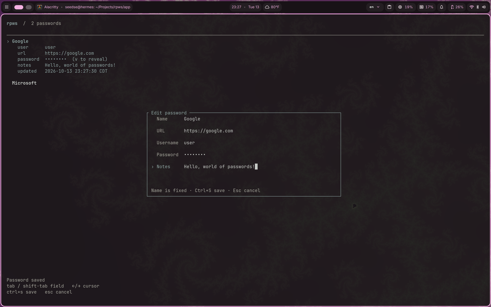
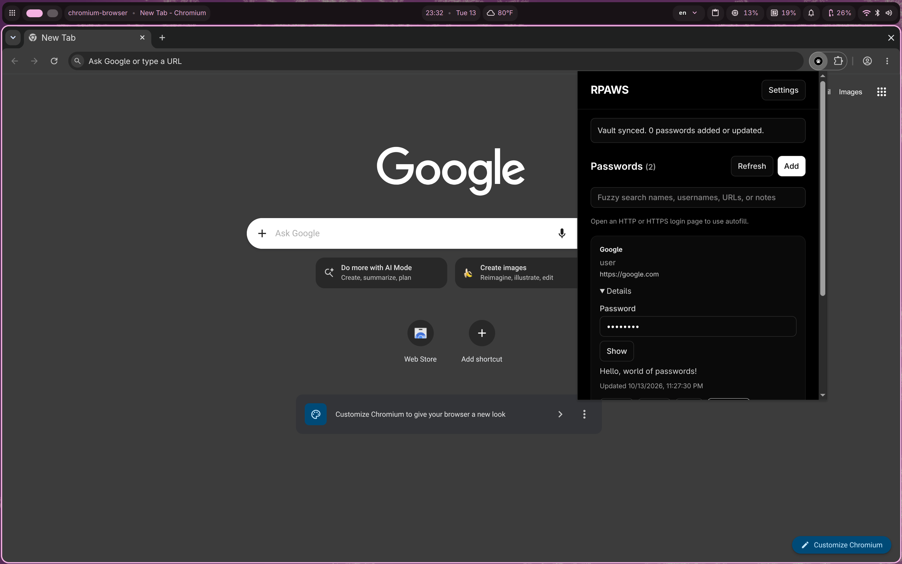
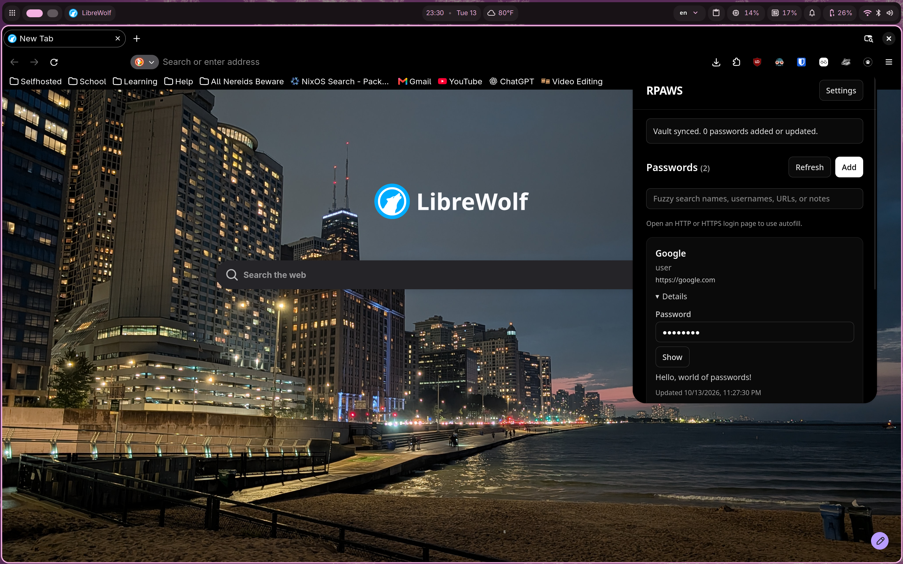

# rpws

A reliable P2P password manager.

RPWS is a P2P password manager that by default utilizes the public IPFS DHT for peer discovery.
Peers are then used to distribute encrypted and authenticated records (passwords!) in the DHT.

All data sent over the network is encrypted and cannot directly reveal passwords to attackers observing traffic.

# Preview

| TUI | RPAWS (Chrome) | RPAWS (Firefox) |
| --- | --- | --- |
|  |  |  |

# Usage

RPWS requires 2 components--a daemon and some sort of client. The `rpws` binary by default includes both of these.
Adding a peer to your network is simple, and the easiest way is simply to use the same secret for all peers.
The DHT will automatically discover peers based on the secret's cryptographic hash.

Running `rpws daemon` will start a server, and this can be set as a service to run in the background.
Then running `rpws` will open a TUI to manage passwords.

Additionally, there are extensions included in this project that can connect to RPWS:
RPAWS (RPWS web client) is available and tested for Chrome and Firefox.

The extension allows generic password auto filling, along with a small menu that pops up for available
password inputs. 

However there is a small caveat.

RPAWS requires a direct connection to a daemon. IE, if you're running the daemon on another computer, you need to be
able to reach the computer in some way (port forwarding, reverse proxy, direct connection, etc).

This does not matter if RPWS's daemon is running on your local machine, then the bootstrap address can simply be set to
`/ip4/127.0.0.1/tcp/7776/p2p/<PEER ID>`. However, again, it's worth noting that the secret must be the same as that in the
config if you'd like to share passwords with the server instead of creating another vault.

The save is automatically saved to your browser, however it's recommended to back up the save to another location, which can
be done from the settings of the extension.

RPWS's core and TUI are built by hand and should be reliable and fully functional. However RPAWS (the browser extensions)
were created with the assistance of AI (GPT 6.1 Sol) and a "perfect experience" is not guaranteed.
